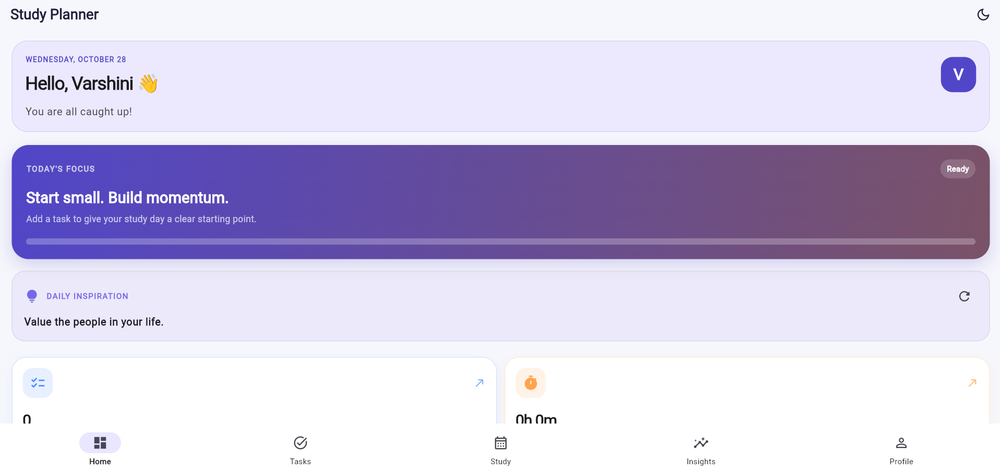
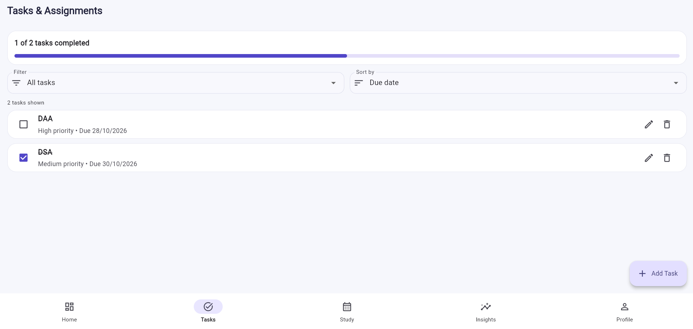
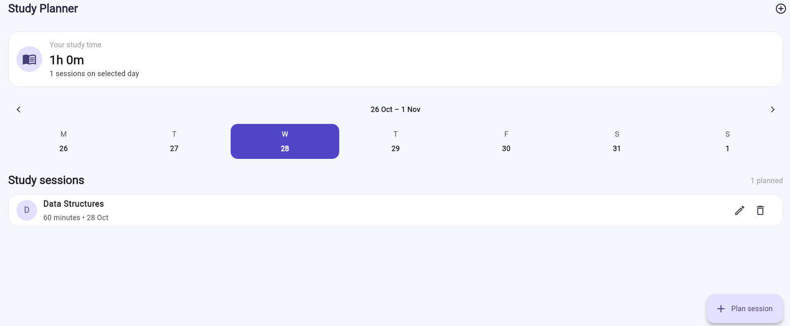
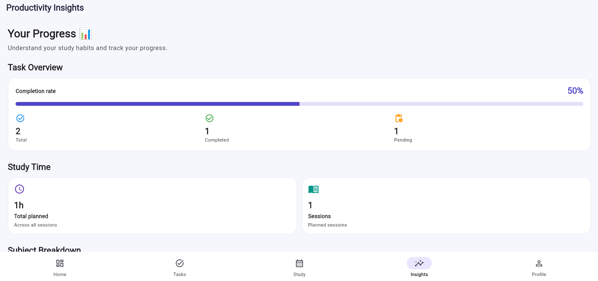
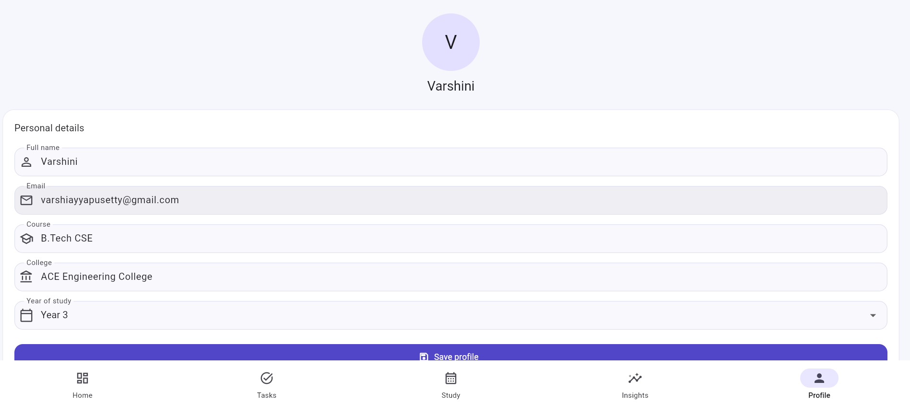

# 📚 Student Productivity Planner

A Flutter-based productivity application that helps students organize academic tasks, plan study sessions, track progress, and build consistent study habits.

## 🚀 Live Demo

**[Open Student Productivity Planner](https://varshiniayyapusetty.github.io/student_productivity_planner/)**

## ✨ Features

- **Personalized Dashboard:** View a personalized greeting, current date, and productivity statistics.
- **Task Management:** Organize tasks, track completion, and manage deadlines.
- **Study Planner:** Plan and record study sessions.
- **Progress Insights:** Monitor task completion and study activity.
- **Profile Management:** Maintain personal and academic details.
- **Daily Study Inspiration:** Fetch study tips through a REST API.
- **Light and Dark Themes:** Switch between themes.
- **Smooth Animations:** Enjoy animated UI elements and transitions.
- **Local Data Persistence:** Save supported application data locally.

## 🛠️ Tech Stack

| Technology | Purpose |
|---|---|
| Flutter | UI framework |
| Dart | Programming language |
| Provider | State management |
| SharedPreferences | Local data persistence |
| REST API and HTTP | Fetching study tips |
| Material 3 | UI components and theming |

## 📸 Screenshots

### Dashboard


### Task Management


### Study Planner


### Insights


### Profile


## 🚀 Getting Started

### Prerequisites

- Flutter SDK
- Dart SDK (included with Flutter)
- Visual Studio Code or Android Studio
- Google Chrome for running the web version

### Installation

**1. Clone the repository**

```bash
git clone https://github.com/VarshiniAyyapusetty/student_productivity_planner.git
```

**2. Navigate to the project directory**

```bash
cd student_productivity_planner
```

**3. Install dependencies**

```bash
flutter pub get
```

**4. Run the application in Chrome**

```bash
flutter run -d chrome
```

To run on a connected device or configured emulator:

```bash
flutter run
```

## 🧪 Testing

Run static analysis:

```bash
flutter analyze
```

Run automated tests:

```bash
flutter test
```

## 📁 Project Structure

```text
lib/
├── models/       # Application data models
├── providers/    # State management
├── screens/      # Application screens
├── services/     # API and service logic
└── main.dart     # Application entry point

test/             # Widget tests
screenshots/      # Application screenshots
```

## 🎯 Project Objective

The Student Productivity Planner brings task management, study scheduling, and progress tracking together in one application to help students manage their academic routines more effectively.

## 🔗 GitHub Repository

[student_productivity_planner](https://github.com/VarshiniAyyapusetty/student_productivity_planner)

---

Built with Flutter and Dart. 🚀
